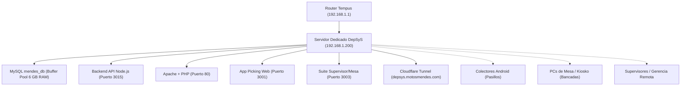

# 🖥️ Guía de Puesta en Marcha: Servidor Dedicado Oficial DepSyS
**Motos Mendes S.A. — Ecosistema DepSyS (Depósito, Picking y Mesas)**  
*Especificaciones del equipo: 16 GB Memoria RAM • 120 GB Almacenamiento SSD/SATA*  
*Fecha de Creación: 03/11/2026*  

---

## 🎯 Objetivo de la Migración
Mudar todo el ecosistema de servidor (MySQL, Apache, Node.js API, Apps Web y Túnel Cloudflare) desde tu PC personal de trabajo hacia un **equipo dedicado y autónomo**.



---

## ⚡ FASE 1: Preparación Física y de BIOS (En la PC Servidor)

### 1.1 Configurar Auto-Encendido en la BIOS (Crítico)
Para que si hay un corte de luz en el depósito, el servidor **se prenda solo** apenas vuelva la energía:
1. Enciende la PC y presiona repetidamente `SUPR` (Delete), `F2` o `F12` para entrar a la BIOS.
2. Busca la pestaña **Power Management** o **Advanced Power**.
3. Busca la opción **"Restore on AC Power Loss"** o **"After Power Loss"**.
4. Cámbiala de *Power Off* a **`Power On`** o **`Last State`**.
5. Presiona `F10` para guardar y salir.

### 1.2 Conexión de Red y Ubicación
* **Conexión:** Obligatoriamente por **cable de red Ethernet (RJ45)** directo al switch/router de Tempus (NUNCA por Wi-Fi para un servidor de base de datos).
* **Alimentación:** Conectarla a un **UPS / Batería** para evitar que se apague en micro-cortes.
* **Operación "Headless":** Una vez configurada, puedes desconectarle el monitor, teclado y mouse; se administrará por Escritorio Remoto (RDP) o AnyDesk/RustDesk.

---

## 🛠️ FASE 2: Preparación del Sistema Operativo Windows

Se recomienda instalar un **Windows 10 Pro o Windows 11 Pro de 64 bits** limpio y formateado.

### 2.1 Configurar IP Local Estática (Fija)
El servidor debe tener siempre la misma dirección IP interna para que los colectores y las mesas nunca pierdan la ruta.

1. Abre PowerShell como Administrador y ejecuta:
```powershell
# Identificar nombre de tu tarjeta Ethernet
Get-NetAdapter | Where-Object { $_.Status -eq "Up" } | Select-Object Name, InterfaceDescription

# Asignar IP Fija recomendada: 192.168.1.200 (Gateway 192.168.1.1)
New-NetIPAddress -InterfaceAlias "Ethernet" -IPAddress "192.168.1.200" -PrefixLength 24 -DefaultGateway "192.168.1.1"

# Configurar DNS rápidos y confiables (Cloudflare + Google)
Set-DnsClientServerAddress -InterfaceAlias "Ethernet" -ServerAddresses ("1.1.1.1", "8.8.8.8")
```

### 2.2 Desactivar Suspensión, Hibernación y Ahorro de Energía
El servidor nunca debe "dormirse":
```powershell
# Plan de Alto Rendimiento y cero suspensiones
powercfg /setactive 8c5e7fda-e8bf-4a96-9a85-a6e23a8c635c
powercfg /change standby-timeout-ac 0
powercfg /change monitor-timeout-ac 10
powercfg /change hibernate-timeout-ac 0
powercfg /hibernate off
```

### 2.3 Habilitar Escritorio Remoto (RDP)
Para controlarlo desde tu PC de trabajo sin moverte de tu escritorio:
```powershell
Set-ItemProperty -Path 'HKLM:\System\CurrentControlSet\Control\Terminal Server' -name "fDenyTSConnections" -value 0
Enable-NetFirewallRule -DisplayGroup "Remote Desktop"
```

---

## 📦 FASE 3: Software Base a Instalar

Descarga e instala en el nuevo servidor las herramientas base:

1. **Git for Windows:** [git-scm.com](https://git-scm.com/download/win)
2. **Node.js LTS (v20 o v22):** [nodejs.org](https://nodejs.org) *(Marcar opción de agregar a PATH)*.
3. **MySQL Server 8.0 o MariaDB 10.11:** [dev.mysql.com](https://dev.mysql.com/downloads/mysql/)
4. **Apache 2.4 Win64 + PHP 8.2:** *(Puedes copiar directamente la carpeta `C:\Apache24` y `C:\php` de tu máquina actual).*

---

## 🗄️ FASE 4: Configuración de MySQL (Aprovechando los 16 GB de RAM)

Con 16 GB de RAM podemos destinar **6 GB exclusivos a la memoria caché de MySQL** (`innodb_buffer_pool_size`). Con esto, **todo el catálogo de repuestos de Motos Mendes y los pedidos del día estarán en la memoria RAM**, eliminando por completo cualquier lentitud del disco.

### 4.1 Ajustar archivo de configuración `my.ini`
En la carpeta de MySQL (`C:\ProgramData\MySQL\MySQL Server 8.0\my.ini`):
```ini
[mysqld]
port=3306
basedir="C:/Program Files/MySQL/MySQL Server 8.0/"
datadir="C:/ProgramData/MySQL/MySQL Server 8.0/Data/"
character-set-server=utf8mb4
collation-server=utf8mb4_unicode_ci

# ==========================================
# OPTIMIZACIÓN DE MEMORIA PARA 16 GB DE RAM
# ==========================================
innodb_buffer_pool_size=6G
innodb_log_file_size=512M
innodb_flush_log_at_trx_commit=2
innodb_flush_method=normal
max_connections=150
thread_cache_size=16
table_open_cache=2000
```

### 4.2 Crear Base de Datos y Usuario Oficial de DepSyS
Abre MySQL Command Line y ejecuta:
```sql
CREATE DATABASE IF NOT EXISTS mendes_db CHARACTER SET utf8mb4 COLLATE utf8mb4_unicode_ci;

CREATE USER 'Rafael'@'%' IDENTIFIED BY 'Mendes-1734*';
CREATE USER 'Rafael'@'localhost' IDENTIFIED BY 'Mendes-1734*';

GRANT ALL PRIVILEGES ON mendes_db.* TO 'Rafael'@'%';
GRANT ALL PRIVILEGES ON mendes_db.* TO 'Rafael'@'localhost';
FLUSH PRIVILEGES;
```

### 4.3 Exportar de tu PC e Importar en el Nuevo Servidor
* **En tu PC actual:**
  ```powershell
  mysqldump -u Rafael -p mendes_db > c:\WorkSpace\DepSyS\backup_mendes_db.sql
  ```
* **En el nuevo Servidor:**
  ```powershell
  mysql -u Rafael -p mendes_db < c:\WorkSpace\DepSyS\backup_mendes_db.sql
  ```

---

## 🌐 FASE 5: Migración del Código DepSyS y Servidores

Copia la carpeta completa `c:\WorkSpace\DepSyS` a la misma ruta en el nuevo servidor:  
👉 `c:\WorkSpace\DepSyS`

### 5.1 Apache + PHP
1. Copia `C:\Apache24` y `C:\php` al nuevo equipo.
2. Registra Apache como servicio de Windows:
   ```cmd
   cd C:\Apache24\bin
   httpd.exe -k install
   httpd.exe -k start
   ```

### 5.2 Backend API (Node.js) con PM2 (24/7 sin ventanas abiertas)
Instalaremos **PM2**, el gestor de procesos profesional que mantiene viva la API de Node en segundo plano:
```powershell
# En PowerShell como Administrador:
npm install -g pm2 pm2-windows-service

cd c:\WorkSpace\DepSyS\backend-api
npm install

# Iniciar la API con PM2
pm2 start server.js --name "depsys-backend"

# Configurar para que inicie automáticamente al arrancar Windows
pm2 save
pm2-service-install -n "PM2-DepSyS"
```

### 5.3 Compilar las Apps Web para Producción
En un servidor no ejecutamos `npm run dev` (que gasta CPU y es para desarrollo); dejamos los builds rápidos de producción:
* **App Picking:**
  ```powershell
  cd c:\WorkSpace\DepSyS\app-picking
  npm install
  npm run build
  # Se sirve en el puerto 3001 con 'serve' o a través de Apache
  ```
* **App Supervisor / Mesa:**
  ```powershell
  cd c:\WorkSpace\DepSyS\app-supervisor
  npm install
  npm run build
  ```

---

## 🛡️ FASE 6: Reglas del Firewall de Windows (Abrir Puertos en la LAN)

Para que los celulares, colectores y otras PC de la red del depósito puedan entrar sin bloqueo de Windows Defender:

```powershell
# Abrir puertos de DepSyS en el Firewall de Windows
New-NetFirewallRule -DisplayName "DepSyS - Apache Web (80)" -Direction Inbound -LocalPort 80 -Protocol TCP -Action Allow
New-NetFirewallRule -DisplayName "DepSyS - Picking Movil (3001)" -Direction Inbound -LocalPort 3001 -Protocol TCP -Action Allow
New-NetFirewallRule -DisplayName "DepSyS - Supervisor y Mesas (3003)" -Direction Inbound -LocalPort 3003 -Protocol TCP -Action Allow
New-NetFirewallRule -DisplayName "DepSyS - Backend API Node (3015)" -Direction Inbound -LocalPort 3015 -Protocol TCP -Action Allow
New-NetFirewallRule -DisplayName "DepSyS - MySQL Local (3306)" -Direction Inbound -LocalPort 3306 -Protocol TCP -Action Allow
```

---

## ☁️ FASE 7: Túnel de Cloudflare como Servicio 24/7

Para que la gerencia y supervisores accedan desde internet por `https://depsys.motosmendes.com` sin que dependa de ninguna ventana abierta:

1. Instala `cloudflared` en `C:\cloudflared\cloudflared.exe`.
2. Instálalo como servicio de sistema:
   ```cmd
   cloudflared.exe service install
   net start cloudflared
   ```

---

## 📋 Checklist de Validación Final

Una vez completados los pasos, prueba desde tu PC o celular conectado al Wi-Fi del depósito:

- [ ] **Acceso a Base de Datos:** Conectar HeidiSQL/DBeaver a `192.168.1.200:3306` (OK).
- [ ] **API PHP:** Abrir `http://192.168.1.200/api/DepSyS_Api/status.php` (Responde `{"status":"online"}`).
- [ ] **Backend Node:** Abrir `http://192.168.1.200:3015/api/status` (Responde OK).
- [ ] **Colector Láser Picking:** Abrir en el colector `http://192.168.1.200:3001` (Carga pantalla de recolector).
- [ ] **Pantalla de Mesa:** Abrir en PC de empaque `http://192.168.1.200:3003` (Carga Bancadas).
- [ ] **Prueba de Reinicio:** Reiniciar la PC Servidor y comprobar que a los 60 segundos **todos los servicios están arriba sin tocar ningún teclado**.
