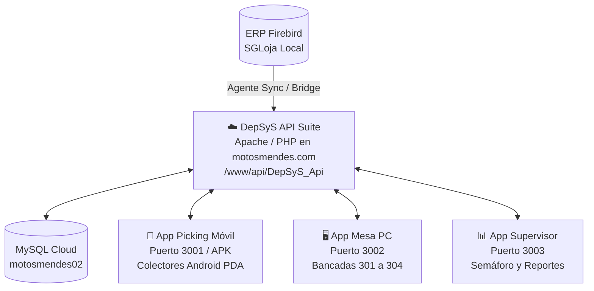

# 🏍️ Motos Mendes S.A. - Manual Operativo DepSyS
**Sistema Integral de Trazabilidad, Picking por Radiofrecuencia y Control de Mesas**

---

## 📋 1. Visión General del Sistema

**DepSyS** es la solución tecnológica diseñada para el depósito central de **Motos Mendes S.A.** para resolver de forma definitiva:
1. **Control de tiempos netos reales:** Eliminación de disputas por demoras nocturnas o descansos; el sistema descuenta automáticamente la jornada no laboral (17:00 a 07:00) y la pausa reglamentaria del café matutino (07:00 a 07:15).
2. **Cero datos ficticios:** Conexión directa en tiempo real con el ERP Firebird 2.5 (`FB_DADOS.FDB` de SGLoja) para validar clientes, notas y piezas reales.
3. **Separación ágil por colectores:** Los operarios separan con lectores láser y reciben feedback auditivo instantáneo (Web Audio API).
4. **Control ergonómico en bancadas:** Las mesas de control (301 a 304) operan con atajos de teclado sin necesidad de usar el mouse.
5. **Panel de supervisión y liquidación de bonos:** Monitoreo en vivo con semáforo de pedidos demorados (> 35 min) y exportación directa a Excel con el KPI clave de *segundos por bip*.
6. **API Centralizada en Apache:** Alojada en `https://www.motosmendes.com/api/DepSyS_Api/` sobre MySQL `motosmendes02`.

---

## 🏗️ 2. Arquitectura de las Aplicaciones



| Módulo | Entorno | Puerto / URL | Dispositivos Destino |
|---|---|---|---|
| **DepSyS API Suite** | Apache + PHP 8 + MySQL | `https://www.motosmendes.com/api/DepSyS_Api/` | Servidor Motos Mendes |
| **Backend Local Bridge** | Node.js Express | `3008` (opcional red interna) | Servidor Local |
| **App Picking** | React + Vite + Capacitor | `3001` (o APK instalable) | Colectores Android PDA (Zebra, Honeywell, etc.) |
| **App Mesa** | React + Vite + Tailwind | `3002` | Computadoras de escritorio en Bancadas 301-304 |
| **App Supervisor** | React + Vite + Tailwind | `3003` | PC del Encargado de Depósito / Gerencia |

---

## 🚀 3. Puesta en Marcha Rápida (1 Clic)

En la carpeta raíz `c:\WorkSpace\DepSyS\`:

- **Para iniciar todo el sistema:**  
  Haga doble clic en **`INICIAR-DEPOSITO.bat`**.  
  El script detectará automáticamente la dirección IP local de la computadora (ej: `192.168.1.50`), levantará los 4 servicios en segundo plano y abrirá el panel del supervisor en el navegador.

- **Para detener todo el sistema:**  
  Haga doble clic en **`DETENER-DEPOSITO.bat`**.  
  Cerrará de forma limpia todos los procesos de Node y liberará los puertos.

---

## 📱 4. Guía de Operación: Colector Móvil (App Picking en APK o Web)

### Instalación del APK Nativo en Colectores (Zebra, Honeywell, Sunmi, Urovo, etc.):
1. **Archivo Instalador Firmado:**  
   Copie el archivo **[`MendesPicking-DepSystem.apk`](file:///c:/WorkSpace/DepSystem/MendesPicking-DepSystem.apk)** al colector mediante cable USB, tarjeta SD o descargándolo directamente desde el navegador del dispositivo.
2. **Instalación:**  
   Abra el explorador de archivos del colector, toque `MendesPicking-DepSystem.apk` y confirme la instalación.
3. **Firma Propia y Actualizaciones:**  
   El APK está firmado digitalmente con la clave propia de Motos Mendes (`depsystem-picking.keystore`), lo que permite que en el futuro cualquier actualización se instale **directamente encima sin necesidad de desinstalar la app previa ni perder configuraciones**.
4. **Compilación en 1 Clic:**  
   Para generar una nueva versión del APK tras realizar cambios en el código, simplemente ejecute:
   - **`c:\WorkSpace\DepSystem\COMPILAR-APK.bat`** (o `app-picking\build_apk.bat`).

### Configuración de la IP del Servidor Central:
- Al abrir la app en el colector, en la pantalla de selección de operario encontrará un botón de engranaje **⚙️ (Configuración)** en la esquina superior derecha.
- Ingrese la dirección IP de la computadora servidora (ejemplo: `192.168.1.154:3008`) y toque **Guardar**. La app recordará la dirección para siempre.

### Configuración del Lector Láser (PDA):
- En la aplicación del lector láser del colector (DataWedge en Zebra, ScanPal en Honeywell, etc.), configure la salida como:
  - **Output Mode:** *Keystroke Output* / *Keyboard Wedge*.
  - **Basic Data Formatting:** Habilitar envío de tecla `Enter` o `\n` al finalizar la lectura.
- **Modo Manual:** Si un código de barras estuviera dañado, el operario puede escribir el código o SKU en el campo de entrada y presionar la tecla Intro.

### Flujo de Trabajo del Separador:
1. **Identificación:** Seleccionar su nombre en la pantalla de bienvenida.
2. **Seleccionar Pedido:** Escanear la orden de trabajo impresa o tocarla en la lista de pedidos pendientes.
3. **Separación de Repuestos:**
   - Apuntar el láser al código del repuesto.
   - **Tono Agudo:** Bip correcto, repuesto contabilizado.
   - **Tono Grave:** Repuesto incorrecto o no pertenece al pedido.
4. **Entrega en Mesa:** Al completar el 100% de las piezas, se abrirá la ventana de entrega para seleccionar la mesa de destino (ej: *Mesa 301*). El cronómetro de picking se detiene automáticamente.

---

## 🖥️ 5. Guía de Operación: Terminal de Bancada (App Mesa)

### Acceso:
En las computadoras de cada mesa física de empaque, abrir el navegador en:
```
http://localhost:3002
```

### Configuración de la Mesa:
- En la primera apertura o pulsando en el botón superior de mesa, seleccione qué mesa física es este puesto (ej: **Mesa 301**, **Mesa 302**, etc.). La preferencia se guardará en el navegador.

### Atajos de Teclado (Mouse-Free):
Para máxima agilidad de empaque, los guardadores pueden operar sin tocar el ratón:
- **`[ Barra Espaciadora ]`**: Iniciar revisión del siguiente pedido en cola / Pausar momentáneamente.
- **`[ Enter ]`**: Finalizar empaque de la nota revisada y dar salida al despacho.

---

## 📊 6. Guía de Operación: Supervisor Central y Semáforo

### Acceso:
En la computadora del encargado de depósito:
```
http://localhost:3003
```

### Funciones Principales:
1. **Botón Maestro de Pausa de Jornada:**
   - Ubicado en la cabecera superior.
   - Permite pausar todas las actividades del depósito simultáneamente ante un corte de luz imprevisto o reunión general.
   - Mientras esté activo, el cronómetro de todas las notas en curso queda completamente suspendido.
2. **Semáforo de Demoras (> 35 min):**
   - Cualquier pedido cuyo tiempo neto supere los 35 minutos se destacará con un destello rojo intermitente (beacon) para alertar al encargado de intervenir.
3. **Monitor Bento Grid de Mesas:**
   - Muestra en tiempo real la ocupación de cada mesa (301 a 304), la nota que están revisando y cuántas tienen en cola.
4. **Auditoría Forense por Pedido:**
   - Al hacer clic en cualquier pedido, se abre la ventana de auditoría completa con el historial segundo a segundo de cada bip escaneado y los operarios intervinientes.

---

## 📈 7. Reportes Mensuales y Liquidación de Bonos

En la pestaña **`📊 Reportes & Liquidación`** de la App de Supervisión:
- **Filtro por Período:** Selección de mes y año para evaluar el rendimiento.
- **Leaderboard de Separadores:**
  - Podio del operario más rápido y con mayor cantidad de piezas.
  - Métrica de **Segundos por Bip:** Indicador de destreza y rapidez manual de separación.
- **Leaderboard de Guardadores:**
  - Total de pedidos revisados y promedio de minutos por empaque.
- **Exportación Directa a Microsoft Excel:**
  - Pulsando el botón **"Exportar a Excel / CSV"**, el sistema descarga un archivo tabular codificado con BOM UTF-8 y punto y coma (`;`), abriéndose de forma nativa en Excel en español sin requerir conversiones.

---

## 👥 8. Catálogo Oficial de Personal (Sincronizado desde Firebird ERP)

Todos los usuarios del sistema provienen directamente de la tabla `ADM_USUARIO` del ERP Firebird y se gestionan en `mendes_db.tbl_operarios`. **Ningún usuario está codificado de forma estática en las aplicaciones.**

- **23 Separadores Oficiales:**
  - Códigos: `SEP201` a `SEP222`, y `SEP305`.
  - Operarios: Fernando Baez, Pablo Jose Ortega, Braian Gonzalez, David Fernandez, Pablo Baez, Blas Quintana, Juan Almiron, Arnaldo Bogado, Henrry Lugo, Lucas Peralta, Alberto Ferreira, Osmar Gonzalez, Hugo Peralta, Esteban Alozo, Joselino, Maxsuel Goncalves, Alfredo Dominguez, Juan Miguel Diaz, Fernando Bogado, Narciso Benitez, Esteban Benitez, Wilfrido Portillo, Richard Peralta.
- **19 Guardadores Oficiales (Mesas de Conferencia):**
  - Códigos: `GRD301` a `GRD320` (excluyendo 305).
  - Operarios: Ramon Cardozo, Leonardo Colman, Herminio Aguirre, Eliel Dias, Cristian Benitez, Paulo Ferreira, Ever Cardozo, Adriel Dias, Alex Maciel, Luciano Lopez, Cristian Sanabria, Ever Alonzo, Paulo Henrique, Rafael Candia, Lucas Mendieta, German Valdez, y guardadores 318, 19, 20.
- **3 Supervisores Oficiales:**
  - `SUP006`: Marcos Rodriguez (Gerente Depósito)
  - `SUP011`: Julio Cesar Ramirez (Expedición)
  - `SUP008`: Rafael de Oliveira (Marketing)

---

## 📦 9. Gestión de Faltantes y Discrepancias de Stock (Fase 8)

### Directiva de Seguridad del ERP:
El ERP Firebird (`FB_DADOS.FDB`) opera bajo la directiva de **100% SOLO LECTURA (SELECT puro)**. DepSystem nunca emite sentencias de inserción, actualización ni borrado en Firebird. Toda la trazabilidad y registro de discrepancias se almacena exclusivamente en MySQL (`mendes_db`).

### Flujo del Botón "No Hay" en el Colector:
1. Si un separador busca un repuesto en la estantería y no lo encuentra, presiona el botón **"No Hay"** en la tarjeta del ítem.
2. Ingresa el motivo (ej: *"No se encuentra en pasillo asignado"*, *"Estante vacío"*).
3. **El cronómetro de picking NO se detiene:** El separador continúa con los demás ítems de la nota para no perjudicar su rendimiento.
4. En segundo plano, DepSystem consulta el stock teórico en Firebird:
   - **Si Firebird indica stock > 0:** Se dispara una **Alerta Urgente de Verificación Física** al Supervisor para que corrobore si el producto está en otro pasillo o mal ubicado.
   - **Si Firebird indica 0 stock:** Queda registrado como faltante confirmado de sistema.

### Panel de Discrepancias del Supervisor:
- Acceso en la App de Supervisión: Módulo **Discrepancias de Stock**.
- El supervisor revisa físicamente el estante y puede:
  - **Confirmar Faltante:** Habilita el **Cierre Parcial** de la nota sin descontar puntuación ni penalizar tiempos al separador.
  - **Producto Hallado:** Notifica la ubicación real para que se complete la recolección.
- **Alerta de Faltantes Recurrentes:** Si un mismo SKU acumula **3 o más faltantes en los últimos 7 días**, el sistema genera una alerta roja prioritaria para el Supervisor Maestro Marcos con el fin de auditar inventario general.

---

## 🛠️ 10. Mantenimiento y Resolución de Dudas Frecuentes

- **¿Qué pasa si un separador se va a su casa y deja el pedido abierto a las 16:55?**  
  El motor matemático descuenta automáticamente desde las 17:00 hasta las 07:00 del día siguiente, más los 15 minutos de café matutino (07:00 a 07:15). El tiempo neto computado reflejará únicamente los minutos reales trabajados.
- **¿Qué pasa si no hay internet o se corta la conexión exterior?**  
  DepSystem opera de forma 100% local dentro de la red del depósito (Intranet), por lo que continuará funcionando sin ninguna interrupción ante caídas de la conexión a internet.
- **¿Cómo se sincronizan nuevos empleados si ingresa personal nuevo al ERP?**  
  El supervisor puede invocar la sincronización en cualquier momento mediante la API `POST /api/operarios/sincronizar-firebird` o la sincronización automática al inicializar.

