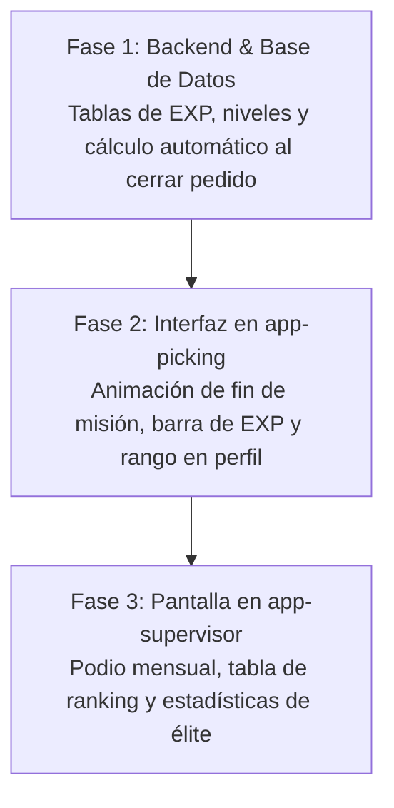

# 🎮 DepSyS Gamification: Sistema de Niveles y Ranking para Separadores

Este documento presenta la propuesta integral para transformar la operación de picking en una experiencia dinámica estilo videojuego (*Warehouse Gamification*). El objetivo es aumentar la productividad, reducir errores de despacho y motivar al equipo mediante metas claras, reconocimiento y progreso visible.

---

## 🧭 1. Concepto Central: Del Trabajo a la Misión

| Elemento Tradicional | Concepto en el Juego | Explicación |
| :--- | :--- | :--- |
| **Nota de Pedido** | 📜 **Misión** | Cada pedido asignado es un contrato o misión a cumplir con dificultad calculada (Fácil, Media, Legendaria según ítems y volumen). |
| **Escaneo de Piezas** | 🎯 **Objetivos de Misión** | Cada SKU encontrado y bipado suma puntos y avanza la barra de la misión. |
| **Velocidad sin Errores** | ⚡ **Combo / Racha de Precisión** | Entregar la nota a tiempo sin faltantes ni discrepancias en mesa activa un multiplicador de experiencia. |
| **Experiencia (EXP)** | 🌟 **Puntos de Experiencia** | La moneda de progreso individual acumulada diariamente. |
| **Niveles y Rangos** | 🎖️ **Estatus Operativo** | Rangos visibles (desde *Aprendiz* hasta *Maestro del Depósito*) que otorgan prestigio en la empresa. |
| **Pantalla de Supervisor** | 🏆 **Leaderboard (Clasificación)** | Ranking en tiempo real con podio (Oro, Plata, Bronce) diario, semanal y mensual. |

---

## 📐 2. La Matemática de la EXP (Fórmula Justa y Anti-Trampas)

Uno de los mayores desafíos en un depósito es evitar la injusticia: **un pedido de 100 arandelas no requiere el mismo esfuerzo que un pedido de 15 productos distintos repartidos en 8 pasillos diferentes.**

Por eso, la ganancia de experiencia se calcula mediante una **fórmula ponderada tridimensional**:

$$\text{EXP Total} = (\text{EXP Pasillo} + \text{EXP Piezas}) \times \text{Multiplicador de Tiempo} + \text{Bono de Calidad}$$

### A. Desglose de Componentes

1. **EXP por Desplazamiento y Búsqueda (SKUs distintos):**
   - **$40\text{ EXP}$ por cada SKU diferente**.
   - *Razón:* Caminar al estante, ubicar la bandeja y verificar el código es donde se consume el mayor esfuerzo físico.

2. **EXP por Manipulación y Conteo (Unidades totales):**
   - **$3\text{ EXP}$ por cada unidad física bipada**.
   - *Razón:* Bipar 20 piezas del mismo SKU aporta experiencia justa sin distorsionar el esfuerzo de búsqueda.

3. **Multiplicador de Velocidad ($M_v$):**
   - El sistema calcula el **Tiempo Estimado Ideal ($T_{est}$)**:
     $$T_{est} = (\text{Cantidad de SKUs} \times 35\text{ seg}) + (\text{Cantidad de Piezas} \times 4\text{ seg})$$
   - Si el separador completa la nota en tiempo real ($T_{real}$):
     - Si $T_{real} \le 0.70 \times T_{est}$ (Súper veloz): **$1.30\times$ (Bonus Legendario)**.
     - Si $T_{real} \le 1.00 \times T_{est}$ (Dentro de meta): **$1.15\times$ (Bonus de Eficiencia)**.
     - Si $T_{real} > 1.30 \times T_{est}$ (Lento): **$1.00\times$ (Sin penalización, solo EXP base)**.

4. **Bono de Calidad / Precisión (Cero Discrepancias):**
   - **$+150\text{ EXP}$** adicional si la mesa de control valida la nota con **100% de coincidencia** (cero faltantes injustificados y cero ítems erróneos).

---

### 🧮 Ejemplo Práctico de Cálculo

#### Caso A: Misión Compleja (Muchos pasillos, pocas piezas)
- **Pedido:** 10 SKUs diferentes, 12 piezas en total.
- **Tiempo Ideal:** $(10 \times 35) + (12 \times 4) = 398\text{ seg}$ (~6.6 min).
- **Tiempo Real:** 5 minutos (Completó dentro del tiempo $\rightarrow$ Multiplicador $1.15\times$).
- **Mesa:** 0 errores ($\rightarrow +150\text{ EXP}$).
- **Cálculo:**
  $$\text{EXP Base} = (10 \times 40) + (12 \times 3) = 400 + 36 = 436\text{ EXP}$$
  $$\text{EXP Final} = (436 \times 1.15) + 150 = 501.4 + 150 \approx \mathbf{651\text{ EXP}}$$

#### Caso B: Misión Rápida (1 solo producto en volumen)
- **Pedido:** 1 SKU, 50 bujías.
- **Tiempo Real:** 2 minutos.
- **Mesa:** 0 errores.
- **Cálculo:**
  $$\text{EXP Base} = (1 \times 40) + (50 \times 3) = 40 + 150 = 190\text{ EXP}$$
  $$\text{EXP Final} = (190 \times 1.15) + 150 = 218.5 + 150 \approx \mathbf{368\text{ EXP}}$$

> [!NOTE]
> Observa cómo el separador que caminó y buscó 10 repuestos diferentes ganó **$651\text{ EXP}$**, mientras que quien solo agarró una caja de 50 bujías ganó **$368\text{ EXP}$**. La fórmula es intrínsecamente justa y premia el esfuerzo real.

---

## 📈 3. Curva de Progresión y Rangos de Operario

Para evitar que los nuevos operadores se desanimen, los primeros niveles se alcanzan rápido (primeros días), y los niveles altos exigen constancia y maestría.

### Tabla de Niveles y Rangos

| Nivel | Título de Rango | EXP Necesaria para el Nivel | Misiones Estimadas |
| :---: | :--- | :---: | :---: |
| **1 - 5** | 🌱 **Separador Aprendiz** | $500 \text{ a } 2.500\text{ EXP}$ | 1 a 5 pedidos (Día 1) |
| **6 - 15** | ⚡ **Operador Ágil** | $3.200 \text{ a } 12.000\text{ EXP}$ | 10 a 25 pedidos (Semana 1) |
| **16 - 30** | 🏹 **Especialista de Pasillo** | $14.000 \text{ a } 38.000\text{ EXP}$ | 30 a 80 pedidos (Mes 1) |
| **31 - 45** | 🛡️ **Capitán de Depósito** | $42.000 \text{ a } 85.000\text{ EXP}$ | 90 a 180 pedidos |
| **46 - 50+** | 👑 **Maestro de Depósito (Leyenda)** | $90.000+ \text{ EXP}$ | 200+ pedidos de élite |

---

## 📱 4. Experiencia de Usuario (UI/UX)

### A. En la App de Picking (`app-picking`)
1. **Tarjeta de Misión al Iniciar:**
   - Dificultad visible: `🟢 Fácil`, `🟡 Normal`, `🔴 Épica (15+ ítems)`.
   - Recompensa estimada: `Recompensa: ~450 EXP`.
2. **Pantalla de Victoria al Entregar en Mesa:**
   - Animación de celebración (+ sonido satisfactorio).
   - Barra de EXP que se llena con sonido tipo arcade.
   - Si sube de nivel: ¡Pantalla de `NIVEL ALCANZADO!` con confetti e insignia nueva.

### B. En la App de Supervisor (`app-supervisor`)
1. **Módulo "Salón de la Fama / Leaderboard":**
   - **Podio con los 3 Mejores del Mes:** Trofeos Oro 🥇, Plata 🥈, Bronce 🥉 con foto o avatar del separador.
   - **Filtros Temporales:** Ranking Diario, Semanal y Mensual (el ranking mensual se reinicia cada mes para dar oportunidad a todos de competir por premios).
   - **Telemetría para Supervisión:** Al hacer clic en un separador, el supervisor ve:
     - Promedio de piezas por hora.
     - Precisión en mesa (% sin errores).
     - Tiempo muerto promedio acumulado.

---

## 🛡️ 5. Blindaje Anti-Fraude y Prácticas Justas
1. **Validación Cruzada con Mesa de Empaque:** La EXP final no se acredita hasta que el guardador de mesa aprueba la recepción de la nota. Si faltan ítems sin justificar, se pierde el bono de calidad.
2. **Rotación Automática:** El algoritmo de distribución asigna pedidos equilibrados para que nadie acapare solo "misiones fáciles".
3. **Temporizador Confiable:** Si una nota se queda abierta sin escaneos por más de 15 minutos, el sistema congela el multiplicador de velocidad para evitar trampas con el tiempo.

---

## 🚀 6. Fases de Implementación Técnica

1. **Fase 1 (Base de Datos & Lógica):** Tablas `operarios_gamificacion` e `historial_exp` en MySQL. Cálculo matemático automático al guardar `fin_separacion`.
2. **Fase 2 (App Picking):** Mostrar nivel actual en el botón de perfil y animación de EXP ganada al completar una orden.
3. **Fase 3 (App Supervisor):** Tablero visual con el Podio de los 3 mejores y ranking general con premios mensuales.
